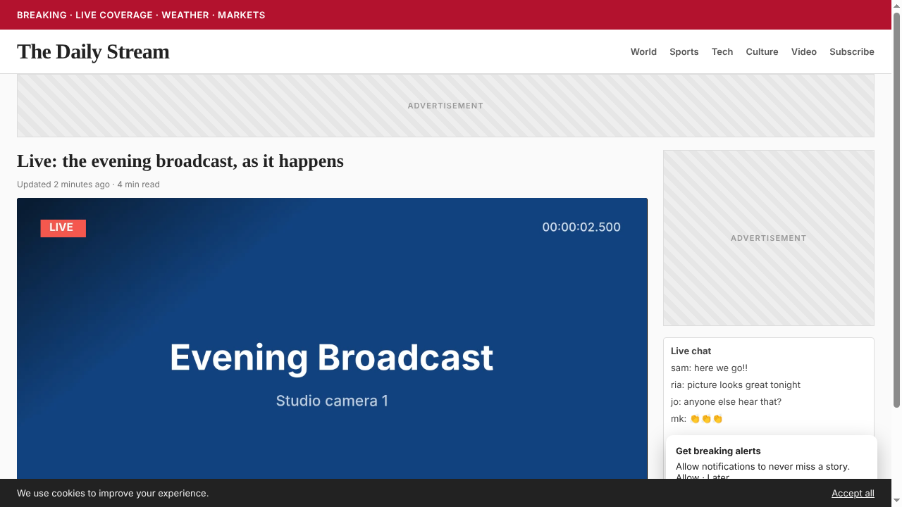
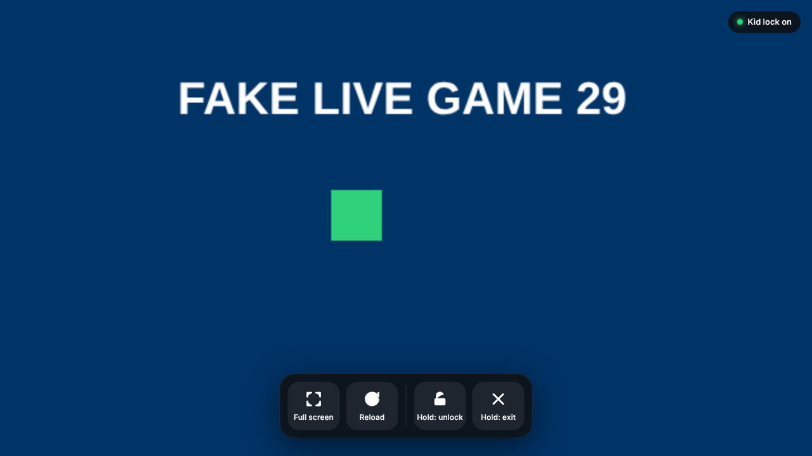
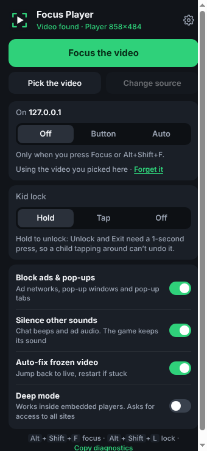
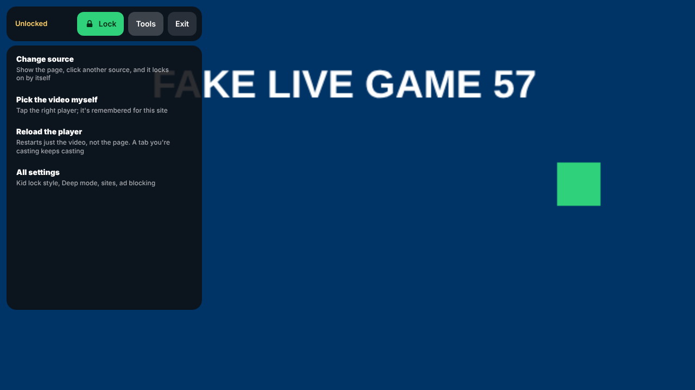
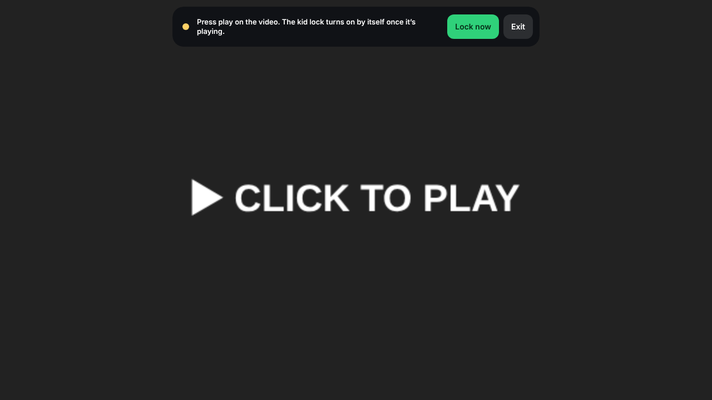
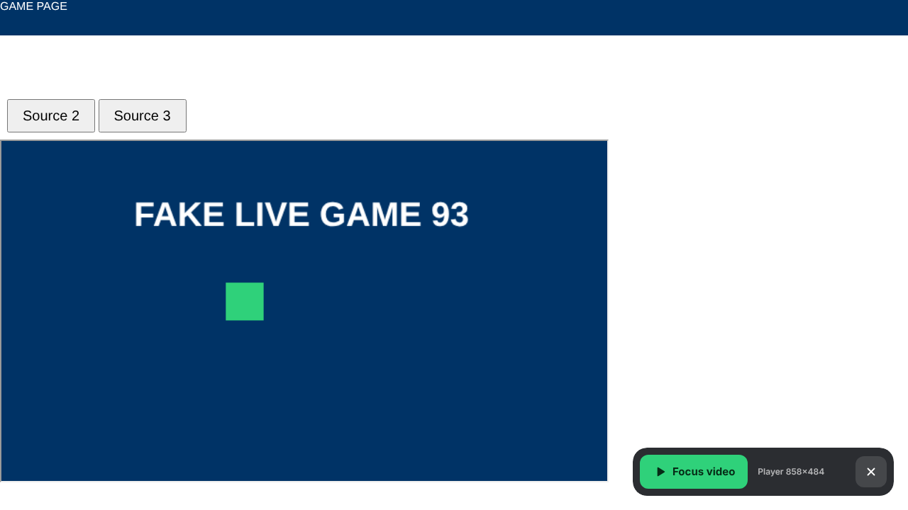
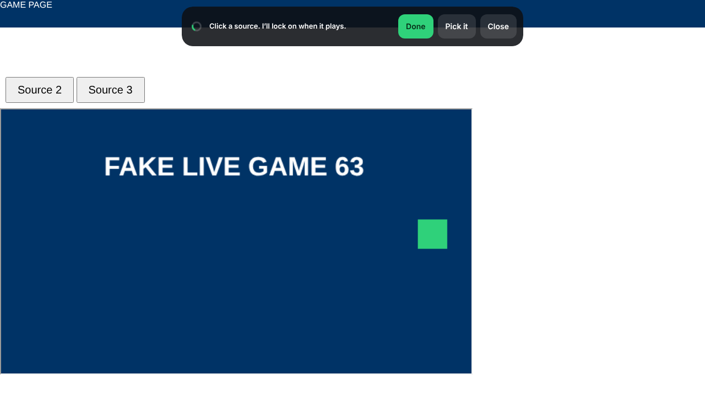
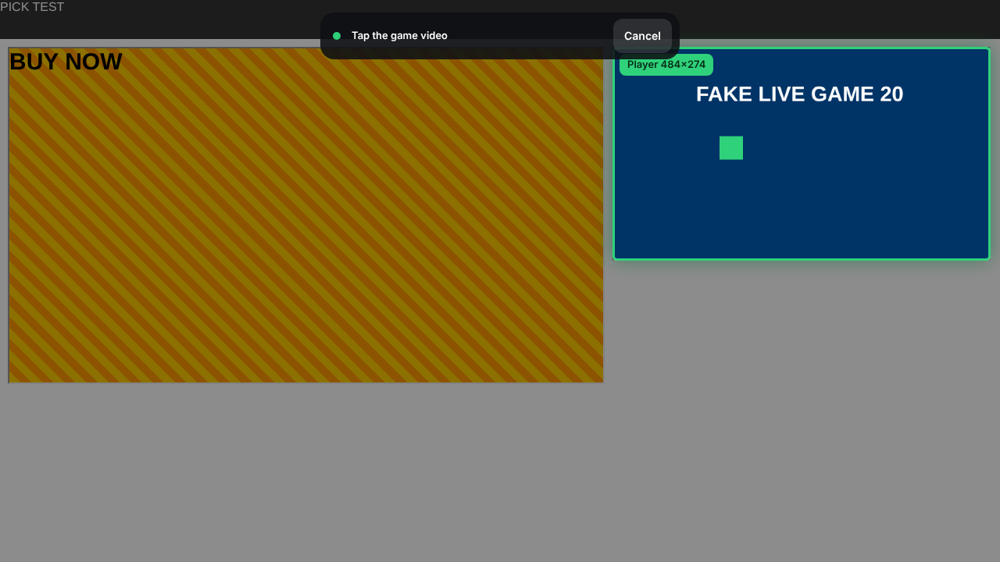

<p align="center"></p>

<h1 align="center">Focus Player</h1>

<p align="center"><b>Watch any web video distraction-free, and hand the laptop to a kid without worry.</b><br>
One click makes the video fill the tab. The rest of the page disappears, a kid lock catches stray taps, and ads, pop-ups and stray sounds are blocked.</p>

<p align="center">
  
  &nbsp;→&nbsp;
  
</p>

Focus Player is a small, dependency-free Chrome extension (Manifest V3). It works on any site that shows video in a normal web player. It isn't tied to any particular site.

---

## Who it's for

| | |
|---|---|
| 👨‍👧 **Parents** | Put a show, a class or a game on the laptop or cast it to the TV. The kid lock means taps from small hands can't open ads, follow links or leave the page. Unlocking takes a deliberate press-and-hold. |
| 📺 **People who cast a browser tab to the TV** | Many web players have no theater mode. Casting the whole tab sends the comments, sidebars and banners along with the video. Focus Player sends just the picture. |
| 👵 **Caregivers & family kiosks** | A grandparent's laptop that should just play the church service, the family call replay or the news. Big buttons, nothing to accidentally click, and frozen streams fix themselves. |
| 🧑‍🏫 **Teachers & presenters** | Show a video on a projector without the comment section, recommendations or ad slots in view. |
| 🎯 **Anyone who wants to focus** | Live events, conference streams, lectures: the video and nothing else, with chat beeps and autoplaying ads muted. |
| ♿ **Accessibility** | Large targets, hold-to-confirm for destructive actions, a keyboard shortcut for everything, and auto-hiding controls. |

## What it does

- **Fills the tab with the video.** It finds the main player on the page, whether a normal video, an embedded player or one hidden inside web components, and hides everything else. Restoring is instant and leaves the page exactly as it was.
- **Kid lock that turns on by itself.** Until the video is actually playing, your clicks reach the player, so you can press its play button. Once it plays, an invisible layer that belongs to the extension covers the video. Taps land on that layer and never reach the website. Choose how unlocking works: **Hold** (a 1.2-second press, the default), **Tap**, or **Off** for plain theater mode.
- **Keeps it playing.** If the page or the player pauses the video while it's locked, Focus Player presses play again. With Deep mode, it also starts a paused embedded player for you.
- **Big, simple controls:** Play, Sound, Volume, Full screen and Reload. They hide themselves and the cursor after 3 seconds.
- **Tells the game from an ad.** It skips standard ad sizes (300×250, 728×90, …) and ad-looking frames. It prefers TV-shaped, full-screen-capable, playing video. If nothing qualifies, it waits instead of filling the screen with an ad.
- **Pick the video.** If it guesses wrong, tap the right player. That choice is remembered for the site.
- **Change source.** The page comes back with a small bar. Click any other source on the page and it locks on to the new player by itself.
- **Auto-fix frozen streams.** If the picture stops, it first jumps back to live. If that doesn't work, it restarts the player in place, so a tab you're casting keeps casting. It backs off and tells you if a feed is truly down.
- **Stays live.** If a live stream drifts more than 30 seconds behind, it catches up. This needs Deep mode for embedded players.
- **Silences everything else.** Chat beeps, ad audio and notification pings are muted. The video you're watching keeps its sound.
- **Blocks ads & pop-ups.** It blocks well-known ad and pop-up networks, turns off scripted pop-up windows, and closes pop-up tabs opened by a page you're watching. Real links you click still open.
- **Per-site behaviour.** Each site can be **Off** (only when you ask), **Button** (a small "Focus video" button appears when a video shows up) or **Auto** (goes straight into focus).
- **Diagnostics.** A link in the popup copies a short report you can paste into an issue.

<p align="center">
  
  &nbsp;
  
</p>

## Install

> New to this? The step-by-step **[Getting started guide](docs/GETTING-STARTED.md)** walks through everything with no technical knowledge needed.

Focus Player isn't in the Chrome Web Store yet. To install from source:

1. Download this repo: **Code → Download ZIP**, then unzip it. Or `git clone https://github.com/variadic-group/focus-player`.
2. Open `chrome://extensions` and turn on **Developer mode** (top right).
3. Click **Load unpacked** and select the **`extension`** folder.
4. Pin Focus Player. Click the puzzle-piece icon in the toolbar, then the pin.

It also works in Edge, Brave, Vivaldi and other Chromium browsers (Chrome 116+). To update, pull or re-download, then click ↻ on the extension card.

## Using it

### Everyday

1. Open a page with a video.
2. Click the toolbar icon, then **Focus the video**. Or just press **Alt+Shift+F**.
   You can do this before the stream loads. It waits and locks on when the video starts.
3. If the video isn't playing yet, press its play button. A bar at the top says so, and the kid lock turns on by itself once the video plays.
4. Hand it over. Moving the mouse or tapping brings up the controls.

<p align="center"></p>

> **Why a press-and-hold?** While locked, a quick tap from a child shouldn't be able to unlock or exit. The hold is the one thing a toddler won't do by accident. If you don't need that, set **Kid lock → Tap** (one tap) or **Off** in the popup.

### Make a site effortless

In the toolbar popup, set the site to **Button** or **Auto**. Chrome will ask once for access to that one site.

| Setting | What happens |
|---|---|
| **Off** | It only does anything when you ask |
| **Button** | A small "Focus video" button appears when a video shows up. One tap to watch. Exiting brings the button back, so getting in and out never involves turning anything on or off |
| **Auto** | It focuses automatically whenever a real video starts |

<p align="center"></p>

### Parent tools

**Hold "unlock" → Tools:**

| Tool | |
|---|---|
| **Change source** | Shows the page with a "Click a source" bar and locks on to whatever you choose |
| **Pick the video myself** | Hover shows a green box, or a red one if it looks like an ad. The choice is remembered per site |
| **Next player on this page** | Only for pages that show several video players at once. Chat boxes and ads are never counted. It doesn't follow links to other sources; use Change source for that |
| **Reload the player** | Restarts just the video player, not the page. A tab you're casting keeps casting |
| **All settings** | Kid lock style, Deep mode, sites, ad blocking |

<p align="center">
  
  &nbsp;
  
</p>

### Keyboard

| Keys | Action |
|---|---|
| **Alt+Shift+F** | Focus / exit |
| **Alt+Shift+L** | Kid lock on / off |
| **Alt+Shift+N** | Next video |
| **Space** | Play / pause (while focused) |
| **M** | Mute |
| **↑ / ↓** | Volume |
| **F** | Full screen |
| **R** | Reload |

You can change the shortcuts at `chrome://extensions/shortcuts`.

## Deep mode (optional)

Most sites put their player inside an embedded frame from another domain. Without extra permission, Focus Player can only work around that frame. It still fills the tab and locks taps, and it detects freezes by comparing tiny snapshots.

Turning on **Deep mode** asks Chrome for access to all sites. It's still only used in a tab where Focus Player is on. It adds:

- Play, Pause and Volume buttons that work on embedded players
- exact freeze detection, plus stay-live catch-up
- pop-up blocking inside the player frames
- silencing chat boxes and widgets that load from other domains

## Ads, pop-ups and the network level

The extension blocks a curated list of ad and pop-up networks ([`extension/rules/ads.json`](extension/rules/ads.json)). It also closes pop-up tabs opened by a page you're focusing or browsing on a Button/Auto site. If a site's player refuses to play with ad blocking on, switch **Block ads & pop-ups** off.

For protection that covers every device and app, filter at the DNS level as well:

- **Cloudflare for Families:** use `1.1.1.3` / `1.0.0.3` to block malware and adult content. Set it on your router so every device gets it. In Chrome alone: Settings → Privacy and security → Security → **Use secure DNS** → custom `https://family.cloudflare-dns.com/dns-query`.
- **NextDNS** or **AdGuard DNS** if you want ad blocking plus your own lists.
- A regular content blocker such as uBlock Origin Lite works well alongside Focus Player.

## Casting tips

- Focus first, then **Cast → Cast tab**. The TV gets only the video, and auto-fix restarts happen inside the tab, so the cast keeps running.
- Chrome doesn't let extensions start, stop or reconnect a cast. If the cast itself drops, restart it from the Cast menu.
- Chrome can't AirPlay. On a Mac, use **Screen Mirroring** with the browser in full screen.
- The most reliable setup has no casting at all: an **HDMI cable**. The next best is wired internet for the laptop and the Chromecast/Apple TV, or 5 GHz Wi-Fi close to the router.

## How it works

```
extension/
  manifest.json      MV3; activeTab + scripting + storage + declarativeNetRequest; optional host access
  background.js      service worker: runs actions, pop-up guard, sound silencer, pop-up tab closer,
                     ad rules on/off, Button/Auto site scripts, freeze snapshots, Deep-mode message hub
  content.js         the brain, top frame only: finds and scores players, focus/pick/source/suggest
                     modes, auto-fix watchdog, diagnostics
  overlay.html/js/css  the kid-lock layer and controls: an extension-owned iframe, so taps
                     never reach the page
  agent.js           Deep mode only: runs inside player frames, reports video state, carries
                     out play/volume/jump-to-live
  popup.*            toolbar popup
  options.*          settings page
  rules/ads.json     ad / pop-up network block list
```

- **Hiding the page:** it marks the chosen player and its ancestors, then uses one stylesheet to hide everything else (`visibility: hidden`) and pin the player full-screen. The page's own layout and scripts are untouched, so exiting is instant.
- **Kid lock:** the lock layer is an iframe served by the extension. Clicks inside an iframe are delivered to that iframe's document, not the page, so a page's "click anywhere to open an ad" handlers never fire.
  - The layer is always full-window and is never resized. It just switches between catching taps and letting them through, because Chrome can briefly misroute taps into a frame that has just grown.
  - The small bars you use while unlocked live in a second, separate frame.
  - As a backstop, any tap that somehow lands on these frames is dropped before the page's own listeners see it.
- **Freeze detection:**
  - Normal video: is `currentTime` advancing?
  - Embedded player with Deep mode: the same check, read from inside the frame.
  - Embedded player without Deep mode: a 48×27 grey thumbnail of the tab is compared every 3 seconds.
  - Recovery is jump-to-live → restart the player → back off after 3 tries in 3 minutes.

## Permissions & privacy

| Permission | Why |
|---|---|
| `activeTab`, `scripting` | Act on the tab you click or press a shortcut in, only then |
| `storage` | Your settings, Button/Auto sites and remembered players, stored locally |
| `declarativeNetRequest` | Block known ad and pop-up network requests |
| *Optional:* one site | When you set a site to Button or Auto |
| *Optional:* all sites | Only if you turn on Deep mode |

There are no servers, accounts, analytics or remote code, and nothing leaves your browser. See [PRIVACY.md](PRIVACY.md).

## Known limits

- Chat or ads drawn *inside* the video player itself can't be hidden. They're part of the player.
- A few sites refuse to play when they detect blocked ads or pop-ups. Turn off **Block ads & pop-ups** for those.
- Players drawn on a `<canvas>` (rare) aren't detected.
- While the page is showing (Change source, Pick, the Focus button), you are browsing the real site. Lock before handing it over.

## Responsible use

Focus Player changes how a page you are already viewing is displayed, and that's all it does. It doesn't download, extract, record or redistribute video, and it doesn't fetch streams on its own. Use it with content you have the right to watch.

## Development

There's no build step. Edit the files in `extension/` and click ↻ in `chrome://extensions`.

End-to-end tests drive real Chrome with the extension loaded, against local test pages in `test/site/`:

```bash
pip install playwright && python -m playwright install chromium
python test/run_tests.py            # needs ffmpeg to generate the test clip/beep
CHROME=/path/to/chrome python test/run_tests.py   # or use a specific Chrome
```

The suite runs 55 checks covering:

- ad avoidance and the start-then-lock flow, for click-to-play players with and without Deep mode
- kid-lock styles
- keeping playback going
- Pick and Change source
- the popup and Button/Auto sites
- pop-up tab blocking, and making sure the Settings tab isn't treated as a pop-up
- Deep-mode controls, stay-live and freeze recovery
- sound silencing, and keeping chat boxes out of player detection
- diagnostics and the ad rules

## Project report

Design goals, architecture, test coverage, known limits and roadmap: [docs/REPORT.md](docs/REPORT.md).

## Contributing

Issues and PRs are welcome. See [CONTRIBUTING.md](CONTRIBUTING.md). The most useful bug report is a diagnostics paste: open the toolbar popup and click **Copy diagnostics**.

## License

[MIT](LICENSE) © variadic-group
