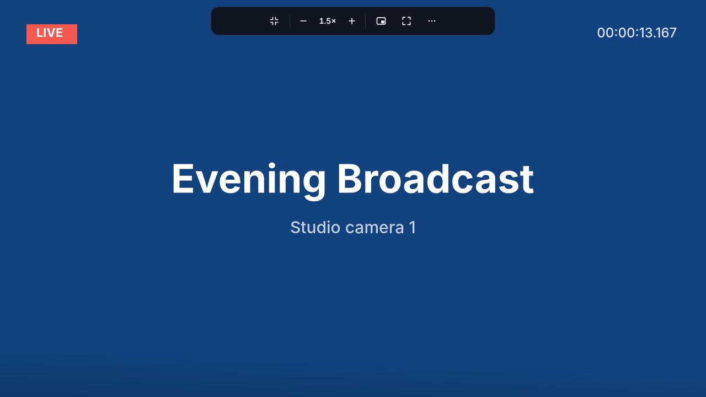
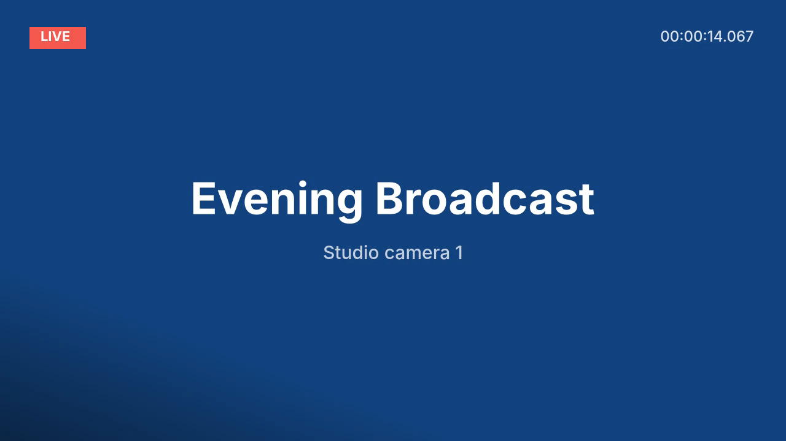
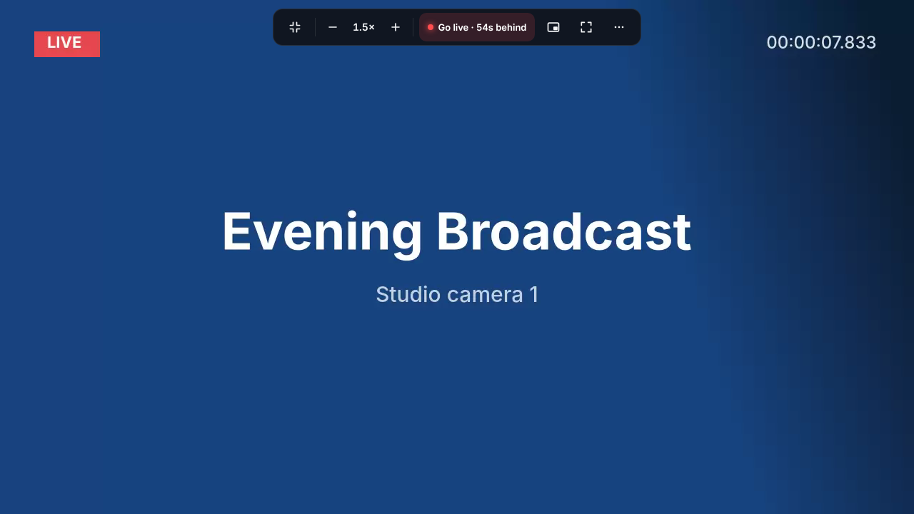

<p align="center"></p>

<h1 align="center">Focus Player</h1>

<p align="center"><b>Theater mode for every website.</b><br>
One key makes any video fill the window. Speed, pop-out, Go live and pop-up blocking come with it, on every site.</p>

<p align="center">
  
  &nbsp;→&nbsp;
  
</p>

<p align="center"><sub>Chrome · Edge · Brave · any Chromium browser &nbsp;·&nbsp; No account, no tracking, nothing leaves your browser &nbsp;·&nbsp; MIT</sub></p>

---

## Why

Video is everywhere on the web, but most pages wrap it in clutter: sidebars, comments, banners, autoplay ads, chat boxes. Theater mode, speed control, picture-in-picture and a live button exist on a few big sites, and only there.

Focus Player brings them to every site, behind one shortcut, without getting in the way of the player you're already using.

## Who it's for

| | |
|---|---|
| 📺 **Live watchers** | Sports, news, esports, launches. Full-window picture, **Go live** when you drift behind, and automatic recovery when a stream stalls. |
| 🎓 **Learners** | Lectures and courses at 1.5× or 2×, remembered for each site, and popped out while you take notes. |
| 🧑‍💻 **Multitaskers** | Picture-in-picture for any video, including ones in embedded players. |
| 🛋️ **People casting a tab** | Cast the tab and the TV shows only the video, not the page around it. |
| 🔇 **The ad-weary** | Pop-up tabs closed, ad networks blocked, autoplay ads and chat pings muted. |
| 🖥️ **Ultrawide & laptop screens** | Zoom to fill crops the black bars. |
| ⌨️ **Keyboard people** | Every action has a shortcut. |

## What it does

- **Theater mode** (`Alt+Shift+F`). Finds the page's main video, even inside embedded players or web components, and fills the window with it. Everything else disappears. Exit with `Esc`, and the page is exactly as it was.
- **Stays out of the way.** The player's own controls keep working. Focus Player adds one slim pill at the top that hides itself and comes back when you hover there.
- **Speed** (`Alt+Shift+.` / `Alt+Shift+,`). 0.25× to 4×, works outside theater mode too, and is remembered for each site.
- **Picture-in-picture** (`Alt+Shift+P`). Pops any video out into a floating window.
- **Go live.** When a live stream is more than 15 seconds behind, a red **Go live** button appears. One click catches up.
- **Recovers stalled streams.** If a *playing* stream stops moving, it catches up to live, then restarts the player in place, so a tab you're casting keeps casting. It backs off and tells you if the stream is really down. Paused videos are never touched.
- **Blocks ads & pop-ups.** Blocks well-known ad and pop-up networks everywhere. In theater mode, it also stops scripted pop-up windows and closes "click anywhere" pop-up tabs. Tabs you open yourself are never touched.
- **Mutes everything else.** In theater mode, autoplay ads, chat pings and notification sounds go quiet, and your video keeps its sound.
- **Zoom to fill.** Crops the black bars on ultrawide or tall screens.
- **Knows the video from the ads.** It skips ad-sized and ad-looking frames, chat boxes and side panels. If nothing qualifies yet, it waits for the video instead of guessing.
- **Pick a different video.** Click the one you want, and it's remembered for that site.
- **Per-site behaviour:** Off, **Button** (a small Theater mode button appears when a video does) or **Always** (goes straight in).

<p align="center">
  
  &nbsp;&nbsp;
  
</p>

## Install

From source, until the Chrome Web Store listing is live:

1. Download the latest **`focus-player-x.y.z.zip`** from [Releases](https://github.com/variadic-group/focus-player/releases) and unzip it.
2. Open `chrome://extensions` and turn on **Developer mode**.
3. Click **Load unpacked** and pick the **`focus-player`** folder. If you cloned the repo, pick the `extension` folder.
4. Pin Focus Player to the toolbar.

To update, replace the folder, then click ↻ on the extension card. A plain-language walkthrough is in [docs/GETTING-STARTED.md](docs/GETTING-STARTED.md).

## Shortcuts

| Keys | Action |
|---|---|
| `Alt+Shift+F` | Theater mode on / off |
| `Esc` | Exit theater mode |
| `Alt+Shift+P` | Picture-in-picture |
| `Alt+Shift+.` / `Alt+Shift+,` | Faster / slower |
| *(set your own)* | Normal speed · Next video · Reload player · Zoom to fill |

You can change any of them at `chrome://extensions/shortcuts`.

## Control embedded players (optional)

Most sites play video inside a player loaded from another domain. Out of the box, Focus Player can fill the window with that player, block pop-ups, and notice when the picture freezes; in that case it offers a **Reload** button.

Turn on **Control embedded players** in the popup, and Chrome will ask for access to all sites. Then speed, picture-in-picture, Go live, automatic stall recovery, and muting chat widgets from other domains all work *inside* those players too. It's only used on a tab when you use Focus Player there.

<p align="center">
  
  &nbsp;
  
</p>

## Casting

Turn on theater mode, then open the Chrome menu → **Cast** → **Cast tab**. The TV gets just the video, and a player restart happens inside the tab, so the cast keeps going.

Chrome doesn't let extensions start or reconnect a cast, and it can't AirPlay. On a Mac, use Screen Mirroring with the browser in full screen.

## Privacy

There are no servers, accounts, analytics or remote code. Settings and per-site choices stay in Chrome's local storage. The stalled-picture check compares a 48×27 grey thumbnail in memory. Full details are in [PRIVACY.md](PRIVACY.md).

| Permission | Why |
|---|---|
| `activeTab`, `scripting` | Act on the tab you invoke it on, only then |
| `storage` | Your settings and per-site choices |
| `declarativeNetRequest` | The bundled ad/pop-up network blocklist |
| *Optional:* one site | When you set it to Button or Always |
| *Optional:* all sites | Only for "Control embedded players" |

## Known limits

- Overlays drawn *inside* a player (its own chat or ads) are part of the player and can't be removed.
- A few sites refuse to play when ads are blocked. Turn **Block ads & pop-ups** off for those.
- Players drawn on a `<canvas>` aren't detected.
- Without "Control embedded players", Focus Player can't tell a paused embedded video from a frozen one, so it offers Reload instead of acting.

## How it works

```
extension/
  manifest.json   MV3 · activeTab, scripting, storage, declarativeNetRequest · optional host access
  content.js      finds and scores players, theater/pick/wait/button modes, stream health, diagnostics
  ui.*            the control pill, menu, pick overlay and Theater button (an extension-owned frame)
  background.js   runs video commands in whichever frame holds the video; pop-up guard, sound muting,
                  pop-up tab closing, ad rules, Button/Always site scripts, frozen-picture check
  agent.js        with "Control embedded players": reports the state of videos inside player frames
  popup.*         toolbar popup        options.*  settings page        rules/ads.json  blocklist
```

There's no build step and no dependencies. Design notes and the product brief are in [docs/REPORT.md](docs/REPORT.md).

## Develop & test

```bash
pip install playwright && python -m playwright install chromium
python test/run_tests.py           # real headless Chrome + the extension; needs ffmpeg for test media
```

The suite loads the extension into real Chrome against local test pages: ad-only pages, click-to-play players, a **stream that stops loading mid-play**, a live stream, a player that pauses itself when resized, a noisy chat widget and a pop-up player. It runs 55 checks on every push.

## Store listing

Copy, permission justifications and graphics for the Chrome Web Store are in [`store/`](store/).

## Contributing

PRs are welcome. Keep it site-agnostic (no per-site rules) and private (no network calls). See [CONTRIBUTING.md](CONTRIBUTING.md). The best bug report is a paste from popup → **Copy diagnostics**.

## License

[MIT](LICENSE) © variadic-group
